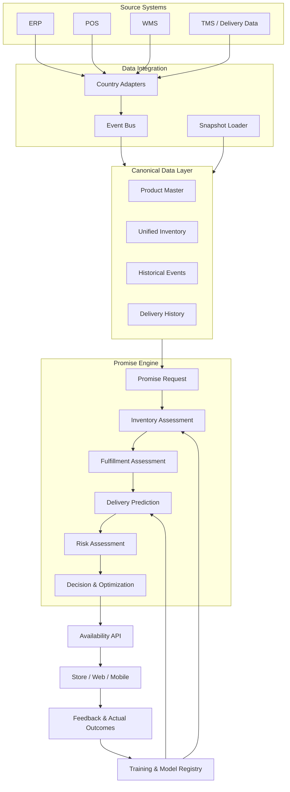
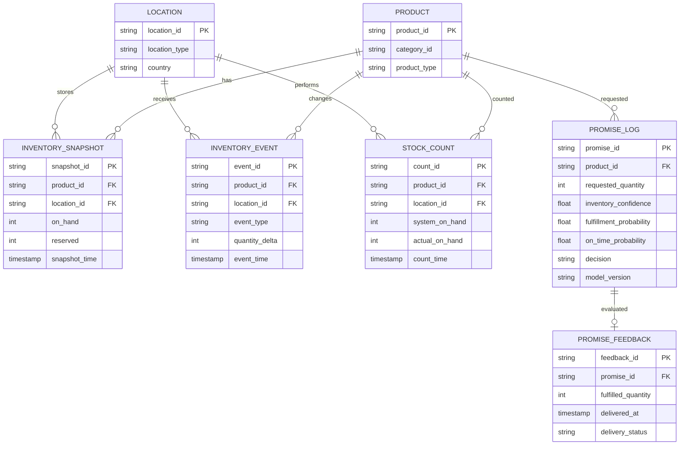

# Promise Engine – Technical Design & Implementation Specification

**Phiên bản:** 1.0  
**Phạm vi:** MVP 12 tuần  
**Mô hình tiếp cận:** Hybrid Rules + Machine Learning + Optimization  
**Kiến trúc triển khai:** Read-only integration với ERP / POS / WMS trong giai đoạn MVP

---

## 1. Mục tiêu và phạm vi

### 1.1. Mục tiêu

Promise Engine là thành phần tính toán khả năng cam kết cung cấp sản phẩm cho khách hàng tại một địa điểm và thời điểm cụ thể.

Đầu vào gồm:

- Sản phẩm và số lượng khách hàng yêu cầu.
- Địa điểm nhận hàng hoặc giao hàng.
- Thời điểm khách hàng mong muốn nhận hàng.
- Tình trạng tồn kho từ các hệ thống nguồn.
- Khả năng xử lý đơn hàng và năng lực giao vận.

Đầu ra gồm:

- Số lượng có thể cam kết.
- Địa điểm có thể đáp ứng.
- Ngày giao hoặc ngày nhận dự kiến.
- Xác suất thực hiện cam kết thành công.
- Mức độ tin cậy của kết quả.
- Lý do và các yếu tố ảnh hưởng đến quyết định.

### 1.2. Nguyên tắc thiết kế

Promise Engine không nên sử dụng một chỉ số duy nhất để quyết định có thể cam kết hay không.

Thay vào đó, cần tách biệt ba nhóm xác suất:

| Thành phần | Ý nghĩa | Câu hỏi cần trả lời |
|---|---|---|
| Inventory Confidence | Độ tin cậy của số liệu tồn kho | Số tồn kho hiện tại có đáng tin không? |
| Fulfillment Probability | Xác suất đáp ứng đủ số lượng | Có thể lấy đủ hàng để thực hiện đơn không? |
| On-time Delivery Probability | Xác suất giao đúng hạn | Hàng có thể đến đúng ngày đã hứa không? |

Kết quả cuối cùng là xác suất thực hiện thành công toàn bộ lời hứa.

### 1.3. Phạm vi MVP

MVP tập trung vào:

- Một quốc gia thí điểm.
- Khoảng 15 cửa hàng và 1 Distribution Center.
- Một tập SKU được lựa chọn.
- Dữ liệu đọc từ ERP, POS và WMS.
- Tính toán khả năng đáp ứng theo tồn kho và quy tắc vận hành.
- Dự báo ngày giao dựa trên lịch sử giao hàng.
- Ghi nhận kết quả thực tế để phục vụ huấn luyện mô hình.

Không thực hiện ghi ngược hoặc cập nhật tồn kho vào hệ thống nguồn trong MVP.

---

# 2. Kiến trúc tổng thể

## 2.1. Kiến trúc logic



## 2.2. Các thành phần chính

| Thành phần | Trách nhiệm |
|---|---|
| Country Adapters | Kết nối và chuyển đổi dữ liệu từ hệ thống nguồn |
| Event Bus | Truyền tải các thay đổi tồn kho và giao dịch |
| Canonical Data Layer | Chuẩn hóa dữ liệu sản phẩm, địa điểm và tồn kho |
| Inventory Assessment | Đánh giá độ tin cậy và khả năng có hàng |
| Fulfillment Assessment | Xác định các nguồn có thể đáp ứng đơn |
| Delivery Prediction | Dự báo ngày giao và khả năng giao đúng hạn |
| Risk Assessment | Tổng hợp các rủi ro ảnh hưởng đến lời hứa |
| Decision & Optimization | Chọn phương án cam kết phù hợp |
| Feedback & Training | Ghi nhận kết quả thực tế và huấn luyện lại mô hình |

---

# 3. Thiết kế dữ liệu huấn luyện

Đây là nền tảng quan trọng nhất của Promise Engine. Mô hình chỉ có thể dự báo đáng tin cậy nếu dữ liệu phản ánh được cả trạng thái tại thời điểm ra quyết định và kết quả thực tế sau đó.

## 3.1. Nguồn dữ liệu

| Nguồn | Dữ liệu cần lấy | Mục đích |
|---|---|---|
| ERP | Product, inventory, reserved stock, purchase orders | Trạng thái tồn kho và sản phẩm |
| POS | Sales transactions, returns, stock adjustments | Tốc độ tiêu thụ và biến động tồn kho |
| WMS | Receipts, picking, packing, stock movements | Khả năng xử lý đơn và tồn kho thực tế |
| TMS / Carrier | Shipment, tracking, delivery timestamps | Huấn luyện mô hình giao hàng |
| Store / DC | Stock count, cycle count, discrepancy | Xác định độ chính xác tồn kho |
| Promise Engine | Promise requests, decisions, confidence, reasons | Lưu lại dự báo tại thời điểm cam kết |

Nếu MVP chưa kết nối được TMS, có thể sử dụng lịch sử giao hàng hiện có từ ERP hoặc WMS, nhưng cần đánh giá chất lượng và mức độ đầy đủ của dữ liệu này.

## 3.2. Các nhóm dữ liệu huấn luyện

### A. Product và Location

Mô tả đặc điểm sản phẩm và địa điểm lưu kho.

| Field | Type | Description |
|---|---|---|
| product_id | string | ID sản phẩm chuẩn |
| category_id | string | Nhóm sản phẩm |
| product_type | string | Loại sản phẩm |
| storage_type | string | Điều kiện lưu trữ |
| location_id | string | Store hoặc DC |
| location_type | string | STORE / DC |
| country | string | Quốc gia |
| region | string | Khu vực |
| handling_class | string | Nhóm xử lý hàng hóa |

Những thuộc tính này có thể ảnh hưởng đến sai lệch tồn kho, tốc độ xử lý đơn và thời gian giao hàng.

### B. Inventory Snapshot

Lưu lại trạng thái tồn kho tại từng thời điểm.

| Field | Type | Description |
|---|---|---|
| snapshot_id | string | ID snapshot |
| product_id | string | Sản phẩm |
| location_id | string | Địa điểm |
| snapshot_time | timestamp | Thời điểm ghi nhận |
| on_hand | integer | Số lượng hệ thống ghi nhận |
| reserved | integer | Số lượng đã giữ chỗ |
| allocated | integer | Số lượng đã phân bổ |
| inbound | integer | Số lượng hàng đang về |
| last_count_time | timestamp | Lần kiểm kê gần nhất |
| source_updated_at | timestamp | Thời điểm hệ thống nguồn cập nhật |
| received_at | timestamp | Thời điểm Promise Hub nhận dữ liệu |

**Lưu ý:** `source_updated_at` và `received_at` cần được lưu riêng để xác định độ trễ đồng bộ.

### C. Inventory Events

Lưu các sự kiện làm thay đổi tồn kho.

| Field | Type | Description |
|---|---|---|
| event_id | string | ID sự kiện |
| product_id | string | Sản phẩm |
| location_id | string | Địa điểm |
| event_type | string | SALE / RETURN / RECEIPT / ADJUSTMENT / TRANSFER |
| quantity_delta | integer | Thay đổi số lượng |
| event_time | timestamp | Thời điểm nghiệp vụ |
| received_at | timestamp | Thời điểm hệ thống nhận |
| source_system | string | ERP / POS / WMS |
| transaction_id | string | ID giao dịch nguồn |

Dữ liệu event cần hỗ trợ xử lý trùng lặp, sự kiện đến muộn và sai thứ tự.

### D. Inventory Count và Discrepancy

Đây là dữ liệu quan trọng để huấn luyện Inventory Confidence Model.

| Field | Type | Description |
|---|---|---|
| count_id | string | ID kiểm kê |
| product_id | string | Sản phẩm |
| location_id | string | Địa điểm |
| count_time | timestamp | Thời điểm kiểm kê |
| system_on_hand | integer | Tồn kho hệ thống trước kiểm kê |
| actual_on_hand | integer | Tồn kho thực tế |
| discrepancy | integer | Chênh lệch |
| discrepancy_ratio | float | Tỷ lệ chênh lệch |
| count_type | string | CYCLE_COUNT / FULL_COUNT |
| verified | boolean | Kết quả đã xác minh hay chưa |

Công thức:

$$
Discrepancy = SystemOnHand - ActualOnHand
$$

$$
DiscrepancyRatio =
\frac{|SystemOnHand-ActualOnHand|}
{\max(ActualOnHand,1)}
$$

Ví dụ:

- Hệ thống ghi nhận: 20 sản phẩm.
- Kiểm kê thực tế: 17 sản phẩm.
- Discrepancy = 3.
- Discrepancy Ratio = 17.65%.

Không nên coi mọi kết quả kiểm kê là nhãn tuyệt đối chính xác nếu quy trình kiểm kê có sai số. Cần lưu nguồn, thời điểm và phương pháp xác minh.

### E. Delivery và Fulfillment History

Dữ liệu dùng để huấn luyện Delivery Prediction Model.

| Field | Type | Description |
|---|---|---|
| order_id | string | ID đơn hàng |
| product_id | string | Sản phẩm |
| quantity | integer | Số lượng |
| source_location_id | string | Kho/cửa hàng xuất hàng |
| destination_id | string | Điểm nhận |
| order_created_at | timestamp | Thời điểm tạo đơn |
| order_cutoff_time | timestamp | Thời điểm cutoff |
| picking_started_at | timestamp | Bắt đầu picking |
| picking_completed_at | timestamp | Hoàn tất picking |
| packed_at | timestamp | Hoàn tất đóng gói |
| shipped_at | timestamp | Thời điểm xuất hàng |
| promised_at | timestamp | Thời điểm đã cam kết |
| delivered_at | timestamp | Thời điểm giao thực tế |
| carrier_id | string | Đơn vị vận chuyển |
| delivery_type | string | HOME / STORE_PICKUP |
| delivery_status | string | Trạng thái cuối cùng |

Nếu có dữ liệu, bổ sung:

- Route distance.
- Number of stops.
- Warehouse workload.
- Carrier capacity.
- Weather hoặc seasonal features.
- Failed delivery attempts.
- Delivery exception reason.

Không bắt buộc phải có toàn bộ các trường này trong MVP.

### F. Promise Decision Log

Mọi quyết định phải được lưu lại để đánh giá mô hình.

| Field | Type | Description |
|---|---|---|
| promise_id | string | ID lời hứa |
| request_time | timestamp | Thời điểm yêu cầu |
| product_id | string | Sản phẩm |
| requested_quantity | integer | Số lượng yêu cầu |
| destination_id | string | Điểm nhận |
| selected_source_id | string | Nguồn cung được chọn |
| inventory_confidence | float | Độ tin cậy tồn kho |
| fulfillment_probability | float | Xác suất đáp ứng đủ hàng |
| on_time_probability | float | Xác suất giao đúng hạn |
| promise_success_probability | float | Xác suất thành công tổng thể |
| promised_at | timestamp | Ngày đã hứa |
| decision | string | PROMISE / VERIFY / REJECT |
| decision_reason | json | Các yếu tố ảnh hưởng |
| rules_version | string | Phiên bản luật |
| model_version | string | Phiên bản mô hình |

**Yêu cầu bắt buộc:** lưu các feature và kết quả tính toán tại thời điểm ra quyết định. Không được dùng dữ liệu cập nhật sau này để tái tạo giả định rằng hệ thống đã biết thông tin đó tại thời điểm cam kết.

---

# 4. Xây dựng nhãn huấn luyện (Training Labels)

Cần xây dựng nhãn riêng cho từng bài toán, thay vì huấn luyện một mô hình tổng hợp ngay từ đầu.

## 4.1. Inventory Confidence Model

**Mục tiêu:** dự báo khả năng số liệu tồn kho hệ thống nằm trong sai số chấp nhận được so với tồn kho thực tế.

Nhãn nhị phân:

$$
Y_{inventory} =
\begin{cases}
1 & \text{Nếu } |SystemStock-ActualStock| \leq Tolerance\\
0 & \text{Ngược lại}
\end{cases}
$$

Ví dụ:

- Tolerance = 1 sản phẩm hoặc một tỷ lệ sai lệch được nghiệp vụ phê duyệt.
- Hệ thống ghi 20, kiểm kê 19 → nhãn 1.
- Hệ thống ghi 20, kiểm kê 15 → nhãn 0.

Nên đánh giá thêm các tolerance khác nhau theo nhóm sản phẩm và quy mô tồn kho.

**Đầu ra mô hình:**

$$
P(InventoryAccurate \mid X)
$$

Đây là xác suất độ chính xác của số liệu tồn kho, không phải xác suất đáp ứng đơn hàng.

## 4.2. Fulfillment Probability Model

**Mục tiêu:** dự báo khả năng đáp ứng đủ số lượng yêu cầu tại một nguồn cung.

Nhãn:

$$
Y_{fulfillment} =
\begin{cases}
1 & \text{Nếu đáp ứng đủ số lượng yêu cầu}\\
0 & \text{Nếu không đáp ứng đủ}
\end{cases}
$$

Nhãn cần được xác định từ kết quả picking/fulfillment thực tế, đối chiếu với số lượng khách yêu cầu.

Ví dụ:

- Requested quantity = 10.
- Picked quantity = 10 → nhãn 1.
- Picked quantity = 8 → nhãn 0 nếu nghiệp vụ yêu cầu đủ 10.

Không nên dùng đơn hàng bị hủy do khách đổi ý làm nhãn thất bại nếu nguyên nhân không liên quan đến tồn kho.

## 4.3. Delivery Prediction Model

**Mục tiêu:** dự báo khả năng giao đúng thời điểm đã cam kết.

Nhãn:

$$
Y_{on\_time} =
\begin{cases}
1 & \text{Nếu DeliveredAt} \leq \text{PromisedAt}\\
0 & \text{Nếu giao muộn}
\end{cases}
$$

Các trường hợp cần xử lý riêng:

- Đơn hủy trước khi xuất kho.
- Đơn không giao được do khách vắng mặt.
- Đơn bị hủy do thiếu hàng.
- Đơn có ngày cam kết bị thay đổi.
- Đơn không có timestamp giao hàng hợp lệ.

Không gộp tất cả các trường hợp trên thành nhãn 0. Cần phân loại nguyên nhân để tránh làm sai lệch mô hình.

## 4.4. Promise Success Model

Trong giai đoạn đầu, có thể tính xác suất thành công tổng thể từ các thành phần.

$$
P(PromiseSuccess)
=
P(FulfillmentSuccess \cap OnTime)
$$

Nếu tạm giả định hai sự kiện độc lập:

$$
P(PromiseSuccess)
\approx
P(FulfillmentSuccess)
\times
P(OnTime)
$$

Đây chỉ là phép xấp xỉ. Trong thực tế, hai yếu tố có thể phụ thuộc nhau, ví dụ kho quá tải vừa làm tăng nguy cơ thiếu hàng vừa làm chậm giao hàng.

Giai đoạn MVP nên dùng phép tính này với giả định được ghi rõ. Khi có đủ dữ liệu, cần xây dựng mô hình xác suất kết hợp hoặc mô phỏng để tính trực tiếp xác suất thành công tổng thể.

---

# 5. Thiết kế Feature Engineering

## 5.1. Features cho Inventory Confidence

| Feature | Mô tả | Nguồn |
|---|---|---|
| stock_age_hours | Số giờ từ lần cập nhật tồn kho gần nhất | ERP / WMS |
| days_since_last_count | Số ngày từ lần kiểm kê gần nhất | Stock Count |
| sales_velocity_7d | Tốc độ bán 7 ngày | POS |
| sales_velocity_30d | Tốc độ bán 30 ngày | POS |
| stock_adjustment_rate | Tỷ lệ điều chỉnh tồn kho | ERP / WMS |
| historical_discrepancy | Sai lệch kiểm kê lịch sử | Stock Count |
| pending_transactions | Số giao dịch chưa đồng bộ | POS / ERP |
| source_latency | Độ trễ dữ liệu nguồn | Integration |
| stock_level | Số lượng tồn kho hiện tại | ERP / WMS |
| product_category | Nhóm sản phẩm | Product Master |
| location_type | Store / DC | Location |

Các feature dạng thời gian phải được tính theo dữ liệu tồn tại tại `request_time`, tránh data leakage.

## 5.2. Features cho Fulfillment

| Feature | Mô tả |
|---|---|
| requested_quantity | Số lượng khách yêu cầu |
| effective_atp | Available-to-Promise sau khi trừ các phần không thể cam kết |
| inventory_confidence | Xác suất độ tin cậy tồn kho |
| sales_velocity | Tốc độ tiêu thụ |
| pending_allocations | Số lượng đang chờ phân bổ |
| inbound_reliability | Độ tin cậy hàng đang về |
| location_type | Loại địa điểm |
| warehouse_capacity | Khả năng xử lý còn lại |
| picking_workload | Khối lượng picking hiện tại |

## 5.3. Features cho Delivery Prediction

| Feature | Mô tả |
|---|---|
| source_location | Kho/cửa hàng xuất hàng |
| destination_region | Khu vực nhận |
| distance | Khoảng cách vận chuyển |
| carrier_id | Đơn vị vận chuyển |
| delivery_type | Hình thức giao |
| order_hour | Giờ tạo đơn |
| order_weekday | Ngày trong tuần |
| cutoff_remaining | Thời gian còn lại đến cutoff |
| picking_workload | Tải xử lý tại kho |
| historical_lane_delay | Lịch sử trễ của tuyến |
| carrier_on_time_rate | Tỷ lệ giao đúng hạn của carrier |
| order_size | Quy mô đơn hàng |
| seasonality | Mùa vụ hoặc dịp cao điểm |

Cần loại bỏ mọi feature chỉ xuất hiện sau khi sự kiện giao hàng đã xảy ra, chẳng hạn `delivered_at`, khi huấn luyện mô hình dự báo trước giao hàng.

---

# 6. Mô hình hóa (Modeling Strategy)

## 6.1. Chiến lược tổng thể

Không nên đưa tất cả bài toán vào một mô hình duy nhất.

Đề xuất ba mô hình độc lập:

| Model | Bài toán | Đầu ra |
|---|---|---|
| Inventory Confidence Model | Độ chính xác tồn kho | Probability 0–1 |
| Fulfillment Model | Khả năng đáp ứng số lượng | Probability 0–1 |
| Delivery Model | Khả năng giao đúng hạn | Probability 0–1 |

Promise Decision Layer tổng hợp kết quả từ các mô hình và luật nghiệp vụ.

## 6.2. Giai đoạn 1 – Rule-based Baseline

Mục tiêu là xây dựng hệ thống hoạt động được ngay cả khi chưa có đủ dữ liệu huấn luyện.

### Inventory Confidence Rules

Khởi tạo confidence = 100, sau đó trừ điểm theo các rủi ro.

Ví dụ:

| Điều kiện | Điểm trừ tham khảo |
|---|---:|
| Không kiểm kê trên 30 ngày | -15 |
| Không đồng bộ giao dịch | -20 |
| Sai lệch lịch sử cao | -20 |
| Sản phẩm có tốc độ bán cao | -10 |
| Dữ liệu nguồn chậm | -15 |

$$
ConfidenceScore =
\max(0,100-\sum Penalties)
$$

Phân nhóm ban đầu:

| Score | Band | Ý nghĩa |
|---:|---|---|
| ≥85 | HIGH | Có thể tiếp tục xét cam kết |
| 65–84 | MEDIUM | Cần kiểm tra thêm hoặc giảm số lượng |
| <65 | LOW | Không nên cam kết tự động |

Các điểm trừ và ngưỡng trên là giá trị khởi tạo để pilot, không phải ngưỡng đã được kiểm chứng. Cần hiệu chỉnh bằng dữ liệu thực tế.

### ATP Calculation

$$
ATP = OnHand - Reserved - Allocated - SafetyBuffer
$$

Trong đó:

$$
SafetyBuffer =
OnHand \times (1-Confidence/100)\times k
$$

`k` là hệ số điều chỉnh ban đầu, ví dụ 0.5. Cần hiệu chỉnh theo nhóm sản phẩm, địa điểm và mức độ rủi ro.

Không đưa inbound stock vào ATP mặc định. Chỉ tính inbound khi:

- Có thời điểm đến dự kiến.
- Có đủ độ tin cậy về nguồn hàng.
- Hàng đến trước thời điểm fulfillment cần thiết.
- Có thể nhận và xử lý hàng đúng quy trình.

### Delivery Rules

$$
EstimatedDelivery =
Cutoff + ProcessingTime + TransitTime
$$

Cần xét thêm:

- Lịch làm việc kho.
- Ngày nghỉ.
- Thời gian picking/packing.
- Thời gian vận chuyển theo tuyến.
- Cutoff của carrier.
- Năng lực xử lý hiện tại.

## 6.3. Giai đoạn 2 – Machine Learning

### A. Inventory Confidence Model

**Mô hình khởi đầu:** Logistic Regression hoặc Gradient Boosting.

Đề xuất:

- Logistic Regression để tạo baseline dễ giải thích.
- LightGBM / XGBoost / HistGradientBoosting để nắm bắt quan hệ phi tuyến.
- Calibrated probabilities để đầu ra phản ánh xác suất thực tế.

Input: các feature trong phần 5.1.

Output:

$$
P(|SystemStock-ActualStock|\leq Tolerance)
$$

Ví dụ:

```json
{
  "inventory_confidence": 0.94,
  "confidence_band": "HIGH"
}
```

### B. Fulfillment Model

Mục tiêu là dự báo khả năng đáp ứng đủ số lượng.

Mô hình đề xuất:

- Logistic Regression baseline.
- Gradient Boosting khi đủ dữ liệu.
- Có thể bổ sung mô hình dự báo phân phối sai lệch tồn kho để tính xác suất có đủ hàng.

Nếu mô hình Inventory Confidence dự báo xác suất số tồn kho chính xác, không nên mặc định dùng trực tiếp xác suất đó như xác suất đáp ứng đơn. Cần kết hợp với số lượng yêu cầu, tồn kho khả dụng, độ lệch tồn kho và quy tắc phân bổ.

### C. Delivery Prediction Model

**Mô hình đề xuất:** Gradient Boosting Classifier.

Mục tiêu:

$$
P(OnTime \mid X)
$$

Đầu ra:

```json
{
  "on_time_probability": 0.96,
  "predicted_delivery_date": "2026-12-10"
}
```

Mô hình nên dự báo xác suất giao đúng hạn theo từng phương án ngày giao, thay vì chỉ dự báo một thời gian vận chuyển trung bình.

### D. Probability Calibration

Đây là bước bắt buộc trước khi dùng xác suất để cam kết.

Các phương pháp:

- Platt Scaling.
- Isotonic Regression.

Đánh giá bằng:

- Brier Score.
- Reliability Diagram.
- Expected Calibration Error (ECE), nếu phù hợp.
- Precision / Recall tại các ngưỡng quyết định.

Ví dụ:

Nếu mô hình đưa ra 100 trường hợp có xác suất thành công 90%, thực tế khoảng 90 trường hợp cần thành công. Nếu chỉ có 70 trường hợp thành công, mô hình đang quá tự tin.

## 6.4. Chia tập dữ liệu huấn luyện

Không nên chia ngẫu nhiên đơn thuần vì dữ liệu có yếu tố thời gian.

Đề xuất:

| Dataset | Khoảng thời gian |
|---|---|
| Training | Các giai đoạn lịch sử đầu tiên |
| Validation | Giai đoạn tiếp theo |
| Test | Giai đoạn gần nhất |

Ví dụ nếu có dữ liệu 12 tháng:

- Training: tháng 1–8.
- Validation: tháng 9–10.
- Test: tháng 11–12.

Cần bảo đảm không để các bản ghi tương lai lọt vào feature của bản ghi quá khứ.

Nên đánh giá thêm khả năng tổng quát hóa giữa các cửa hàng, kho và nhóm sản phẩm.

## 6.5. Điều kiện chuyển từ Rules sang ML

Chỉ bật ML trong production khi:

1. Nhãn huấn luyện đủ số lượng và chất lượng.
2. Dữ liệu có độ phủ hợp lý theo cửa hàng, sản phẩm và thời gian.
3. Mô hình tốt hơn baseline trên tập test độc lập.
4. Xác suất được calibration.
5. Không có suy giảm nghiêm trọng ở nhóm sản phẩm hoặc địa điểm quan trọng.
6. Có model version, monitoring và rollback.

Nếu không đạt điều kiện, tiếp tục dùng Rules.

---

# 7. Quy trình xử lý Promise Request

## 7.1. Bước 1 – Nhận yêu cầu

Đầu vào:

- Product ID.
- Requested quantity.
- Destination.
- Delivery type.
- Requested delivery date.
- Customer service level, nếu có.

Kiểm tra dữ liệu đầu vào và chuẩn hóa product/location identifier.

## 7.2. Bước 2 – Kiểm tra chất lượng dữ liệu

Kiểm tra:

- Sản phẩm đã được mapping đúng chưa.
- Location có tồn tại không.
- Snapshot tồn kho có đủ mới không.
- Event có bị thiếu hoặc chưa đồng bộ không.
- Có transaction trùng lặp không.
- Có dữ liệu bất thường không.

Nếu dữ liệu không đạt yêu cầu, không tự động đưa ra lời hứa có độ tin cậy cao.

## 7.3. Bước 3 – Inventory Assessment

Tính:

- Inventory Confidence.
- Confidence Band.
- ATP.
- Safety Buffer.
- Estimated Available Quantity.

Pseudo-code:

```python
def assess_inventory(stock, reserved, allocated, features):
    confidence = inventory_model.predict_proba(features)

    safety_buffer = (
        stock.on_hand
        * (1 - confidence)
        * stock.buffer_factor
    )

    atp = (
        stock.on_hand
        - reserved
        - allocated
        - safety_buffer
    )

    return {
        "confidence": confidence,
        "atp": max(0, atp)
    }
```

Trong production cần bổ sung validation, làm tròn số lượng, xử lý thiếu dữ liệu và kiểm soát ngưỡng theo nghiệp vụ.

## 7.4. Bước 4 – Fulfillment Assessment

Xác định các nguồn có thể cung cấp sản phẩm:

- DC.
- Store gần khách hàng.
- Các location được phép fulfillment.

Loại bỏ nguồn không đủ điều kiện:

- ATP thấp hơn số lượng yêu cầu.
- Confidence dưới ngưỡng.
- Không có khả năng picking.
- Không đáp ứng cutoff.
- Không hỗ trợ delivery type tương ứng.

## 7.5. Bước 5 – Delivery Prediction

Với mỗi nguồn cung hợp lệ:

1. Xác định thời điểm có thể bắt đầu xử lý đơn.
2. Tính thời gian picking và packing.
3. Tính thời gian vận chuyển.
4. Áp dụng lịch làm việc và cutoff.
5. Tính xác suất giao đúng hạn.
6. Đánh giá các ngày giao khả thi.

## 7.6. Bước 6 – Risk Assessment

Tổng hợp các yếu tố:

- Rủi ro tồn kho.
- Rủi ro fulfillment.
- Rủi ro giao hàng.
- Rủi ro đồng bộ dữ liệu.
- Rủi ro năng lực xử lý.

Xác suất tổng thể trong MVP:

$$
P_{success} =
P_{fulfillment}\times P_{on-time}
$$

Công thức trên chỉ là phép xấp xỉ khi giả định độc lập. Khi có đủ dữ liệu, nên đánh giá mô hình joint probability để xử lý tương quan giữa các yếu tố.

## 7.7. Bước 7 – Promise Decision

Ngưỡng ban đầu đề xuất:

| Probability | Decision | Ý nghĩa |
|---:|---|---|
| ≥95% | PROMISE | Có thể cam kết tự động |
| 85–94.99% | VERIFY | Cần kiểm tra hoặc lựa chọn phương án khác |
| <85% | REJECT | Không nên cam kết |

Các ngưỡng này phải được hiệu chỉnh với Product và Operations dựa trên chi phí giao trễ, hủy đơn, mất doanh thu và tỷ lệ chấp nhận lời hứa.

Không nên chỉ tối đa hóa xác suất thành công. Hệ thống cần cân bằng giữa độ tin cậy và tỷ lệ yêu cầu có thể đáp ứng (Promise Coverage).

## 7.8. Bước 8 – Fulfillment Optimization

Khi có nhiều nguồn cung khả thi, chọn phương án tối ưu.

Hàm mục tiêu tham khảo:

$$
Minimize:
C_{transport}
+C_{handling}
+C_{split}
+C_{delay}
+C_{risk}
$$

Ràng buộc:

- Tổng số lượng được chọn phải đủ số lượng yêu cầu.
- Không vượt quá ATP.
- Không vượt quá năng lực xử lý.
- Phải đáp ứng thời gian giao hàng.
- Tuân thủ các quy định về nguồn cung và vận chuyển.

Công cụ có thể sử dụng:

- Google OR-Tools.
- Mixed Integer Linear Programming (MILP).
- Constraint Programming.

**Giới hạn MVP:** ưu tiên một nguồn cung. Nếu không đủ, thử nguồn DC khác hoặc tối đa hai nguồn cung. Tối ưu multi-source đầy đủ nên để Phase 2.

## 7.9. Bước 9 – Ghi nhận quyết định và Feedback

Mỗi lần đánh giá phải lưu:

- Input request.
- Snapshot dữ liệu đã sử dụng.
- Feature vector.
- Model/rules version.
- Kết quả từng thành phần.
- Quyết định cuối.
- Lý do.
- Kết quả fulfillment thực tế.
- Kết quả giao hàng thực tế.

Feedback được dùng để cập nhật nhãn huấn luyện và đánh giá hiệu quả mô hình.

---

# 8. Thiết kế API

## 8.1. API Overview

| Method | Endpoint | Mục đích |
|---|---|---|
| POST | `/v1/promises/evaluate` | Đánh giá khả năng cam kết |
| GET | `/v1/promises/{promise_id}` | Lấy kết quả đánh giá |
| POST | `/v1/promises/{promise_id}/confirm` | Xác nhận sử dụng lời hứa |
| POST | `/v1/promises/{promise_id}/feedback` | Gửi kết quả thực tế |
| GET | `/v1/availability` | Tra cứu khả năng có hàng |
| GET | `/v1/models/versions` | Xem phiên bản mô hình |
| GET | `/v1/health` | Health check |

Trong MVP có thể triển khai trước ba API chính: evaluate, confirm và feedback. Các API còn lại có thể bổ sung theo nhu cầu tích hợp.

## 8.2. POST /v1/promises/evaluate

**Mục đích:** đánh giá khả năng đáp ứng một yêu cầu và trả về phương án cam kết.

Request:

```json
{
  "request_id": "REQ-10001",
  "product_id": "SKU-001",
  "quantity": 2,
  "destination": {
    "location_id": "STORE-001",
    "type": "STORE_PICKUP"
  },
  "requested_delivery_date": "2026-12-10",
  "delivery_type": "STORE_PICKUP",
  "service_level": "STANDARD"
}
```

Response:

```json
{
  "promise_id": "PRM-10001",
  "request_id": "REQ-10001",
  "decision": "PROMISE",
  "promised_quantity": 2,
  "promised_delivery_date": "2026-12-10",
  "selected_source": {
    "location_id": "DC-001",
    "location_type": "DC"
  },
  "probabilities": {
    "inventory_confidence": 0.98,
    "fulfillment_probability": 0.97,
    "on_time_probability": 0.98,
    "promise_success_probability": 0.9506
  },
  "inventory": {
    "on_hand": 20,
    "reserved": 5,
    "allocated": 2,
    "safety_buffer": 2,
    "atp": 11
  },
  "risk_band": "HIGH",
  "reason_codes": [
    "INVENTORY_DATA_FRESH",
    "STOCK_AVAILABLE",
    "DELIVERY_LANE_RELIABLE"
  ],
  "model_versions": {
    "inventory": "inventory-v1.0",
    "fulfillment": "fulfillment-v1.0",
    "delivery": "delivery-v1.0"
  },
  "evaluated_at": "2026-11-05T10:30:00Z"
}
```

Lưu ý: `promise_success_probability` trong ví dụ được tính bằng `0.97 × 0.98 = 0.9506`, theo giả định độc lập.

### Các giá trị Decision

| Value | Ý nghĩa |
|---|---|
| PROMISE | Có thể cam kết |
| VERIFY | Cần kiểm tra thêm |
| REJECT | Không thể cam kết |

### Các giá trị Risk Band

| Value | Ý nghĩa |
|---|---|
| HIGH | Rủi ro thấp |
| MEDIUM | Cần thận trọng |
| LOW | Rủi ro cao |

Tên `risk_band` cần được hiểu nhất quán: HIGH ở đây là mức độ tin cậy cao, không phải rủi ro cao. Nếu muốn tránh nhầm lẫn, nên đổi thành `confidence_band`.

## 8.3. GET /v1/promises/{promise_id}

Lấy lại kết quả đánh giá đã lưu.

Response:

```json
{
  "promise_id": "PRM-10001",
  "decision": "PROMISE",
  "promised_quantity": 2,
  "promised_delivery_date": "2026-12-10",
  "promise_success_probability": 0.9506,
  "status": "EVALUATED"
}
```

API này nên trả về kết quả lịch sử tại thời điểm evaluate, không tự động tính lại bằng model mới.

## 8.4. POST /v1/promises/{promise_id}/confirm

**Mục đích:** xác nhận rằng hệ thống bán hàng hoặc người dùng đã sử dụng phương án cam kết.

Request:

```json
{
  "confirmed_by": "SYSTEM",
  "confirmed_at": "2026-11-05T10:32:00Z",
  "selected_option": "OPTION-001"
}
```

Response:

```json
{
  "promise_id": "PRM-10001",
  "status": "CONFIRMED",
  "confirmed_at": "2026-11-05T10:32:00Z"
}
```

Đây là bước ghi nhận quyết định nghiệp vụ, không phải lệnh ghi tồn kho vào ERP/WMS.

## 8.5. POST /v1/promises/{promise_id}/feedback

**Mục đích:** ghi nhận kết quả thực tế để đánh giá độ chính xác và huấn luyện mô hình.

Request:

```json
{
  "actual_fulfillment": {
    "requested_quantity": 2,
    "fulfilled_quantity": 2,
    "fulfilled_at": "2026-11-06T08:00:00Z"
  },
  "actual_delivery": {
    "promised_at": "2026-12-10T18:00:00Z",
    "delivered_at": "2026-12-10T15:30:00Z",
    "delivery_status": "DELIVERED"
  },
  "inventory_verification": {
    "system_on_hand": 20,
    "actual_on_hand": 19,
    "counted_at": "2026-11-06T08:00:00Z"
  },
  "failure_reason": null
}
```

Response:

```json
{
  "promise_id": "PRM-10001",
  "feedback_status": "ACCEPTED",
  "labels": {
    "inventory_accurate": true,
    "fulfillment_success": true,
    "on_time": true
  }
}
```

Nhãn `inventory_accurate` cần được tính theo tolerance đã cấu hình. Không nên mặc định mọi sai lệch một đơn vị đều được xem là chính xác.

## 8.6. GET /v1/availability

**Mục đích:** cung cấp thông tin availability cho các hệ thống frontend hoặc POS.

Ví dụ:

```http
GET /v1/availability?product_id=SKU-001&location_id=STORE-001&quantity=2
```

Response:

```json
{
  "product_id": "SKU-001",
  "location_id": "STORE-001",
  "requested_quantity": 2,
  "available_to_promise": 11,
  "inventory_confidence": 0.98,
  "availability_status": "AVAILABLE",
  "evaluated_at": "2026-11-05T10:30:00Z"
}
```

API availability chỉ thể hiện tình trạng có hàng. Nếu cần ngày giao và khả năng thực hiện lời hứa, frontend phải sử dụng Promise Evaluate.

## 8.7. API Error Handling

Chuẩn hóa các lỗi:

| HTTP Status | Error Code | Ý nghĩa |
|---|---|---|
| 400 | INVALID_REQUEST | Request không hợp lệ |
| 401 | UNAUTHORIZED | Chưa xác thực |
| 403 | FORBIDDEN | Không có quyền |
| 404 | PRODUCT_NOT_FOUND | Không tìm thấy sản phẩm |
| 404 | LOCATION_NOT_FOUND | Không tìm thấy địa điểm |
| 409 | DUPLICATE_REQUEST | Request trùng lặp không hợp lệ |
| 422 | DATA_NOT_READY | Dữ liệu chưa đủ để đánh giá |
| 429 | RATE_LIMITED | Vượt giới hạn gọi API |
| 500 | INTERNAL_ERROR | Lỗi nội bộ |
| 503 | SOURCE_UNAVAILABLE | Hệ thống nguồn không khả dụng |

Ví dụ:

```json
{
  "error": {
    "code": "DATA_NOT_READY",
    "message": "Inventory data is too old to provide a reliable promise.",
    "details": {
      "location_id": "STORE-001",
      "product_id": "SKU-001",
      "last_updated_at": "2026-11-04T08:00:00Z"
    }
  }
}
```

## 8.8. API Non-functional Requirements

| Yêu cầu | Mục tiêu MVP |
|---|---|
| API latency | p95 < 500 ms |
| Availability | Theo SLA nội bộ của pilot |
| Authentication | OAuth2 / OIDC |
| Authorization | Role-based access |
| Idempotency | Hỗ trợ request idempotency |
| Observability | Logs, metrics, traces |
| Versioning | `/v1/` |
| Audit | Lưu decision và model version |
| Data privacy | Không sử dụng dữ liệu cá nhân khách hàng trong MVP |

Các ngưỡng hiệu năng cần được kiểm chứng bằng tải thực tế và phụ thuộc vào số lượng location, cách truy vấn và việc sử dụng cache.

---

# 9. Data Model và lưu trữ

## 9.1. Các bảng chính



## 9.2. Công nghệ lưu trữ tham khảo

| Thành phần | Công nghệ |
|---|---|
| Operational database | PostgreSQL |
| Cache | Redis |
| Event streaming | Kafka-compatible event bus |
| Raw historical data | Object Storage |
| Search / diagnostics | OpenSearch, nếu cần |
| ML artifacts | Object Storage + Model Registry |

Không nhất thiết phải triển khai tất cả trong MVP. PostgreSQL, object storage và một event bus phù hợp có thể đáp ứng phần lớn nhu cầu ban đầu.

---

# 10. Đánh giá và giám sát mô hình

## 10.1. Model Evaluation Metrics

| Mô hình | Metric | Mục tiêu đánh giá |
|---|---|---|
| Inventory Confidence | Brier Score | Độ chính xác xác suất |
| Inventory Confidence | Precision / Recall | Phát hiện số tồn kho không đáng tin |
| Fulfillment | Precision / Recall | Dự báo khả năng đáp ứng |
| Delivery | Brier Score | Calibration xác suất giao đúng hạn |
| Delivery | AUC / PR-AUC | Khả năng phân biệt đúng hạn và trễ |
| Promise Engine | Promise Accuracy | Tỷ lệ lời hứa thành công |
| Promise Engine | Promise Coverage | Tỷ lệ yêu cầu được cam kết |

Không đánh giá mô hình chỉ bằng Accuracy. Trong bối cảnh Promise Engine, xác suất được calibration và mức độ kiểm soát false promise quan trọng hơn.

## 10.2. Business KPIs

| KPI | Công thức / Ý nghĩa |
|---|---|
| Inventory Accuracy | Tỷ lệ bản ghi tồn kho nằm trong tolerance |
| Fulfillment Success Rate | Tỷ lệ đơn đáp ứng đủ số lượng |
| Promise Accuracy | Tỷ lệ lời hứa thực hiện thành công |
| On-time Delivery | Tỷ lệ giao đúng hạn |
| Promise Coverage | Tỷ lệ request được cam kết |
| Manual Verification Rate | Tỷ lệ yêu cầu cần kiểm tra thủ công |
| Brier Score | Độ chính xác xác suất dự báo |
| API Response Time | Thời gian phản hồi API |

Cần báo cáo KPI theo:

- Product category.
- Store / DC.
- Country / Region.
- Delivery type.
- Confidence band.
- Requested quantity.
- Model version.

## 10.3. Monitoring và Alerting

Theo dõi các vấn đề:

- Inventory data freshness giảm.
- Event processing lag tăng.
- Tỷ lệ inventory discrepancy tăng.
- Promise accuracy giảm.
- Calibration drift.
- Tỷ lệ request bị VERIFY tăng bất thường.
- Model inference latency tăng.
- Source system mất kết nối.

Khi phát hiện model drift hoặc dữ liệu đầu vào bất thường, hệ thống cần có khả năng chuyển về Rules Baseline.

---

# 11. Kế hoạch triển khai MVP 12 tuần

| Giai đoạn | Tuần | Công việc | Deliverables |
|---|---:|---|---|
| Data Foundation | 1–2 | Kết nối ERP/POS/WMS, canonical schema, snapshot và event | Unified Inventory |
| Inventory Intelligence | 3–4 | Inventory rules, discrepancy, confidence, ATP | Inventory Assessment |
| Rules-based Promise | 5–6 | Promise API, delivery rules, decision logic | Promise Engine v1 |
| ML Enhancement | 7–8 | Chuẩn bị labels, train baseline, calibration | ML models v1 |
| Pilot | 9–10 | Tích hợp frontend, feedback, vận hành thử | Pilot Release |
| Evaluation | 11–12 | Đo KPI, đánh giá model, tối ưu và rollback test | MVP Evaluation Report |

## 11.1. Điều kiện hoàn thành MVP

- Chuẩn hóa được dữ liệu sản phẩm và location.
- Nhận và xử lý được inventory snapshot/event.
- Có Inventory Confidence Rules.
- Tính được ATP.
- Có Delivery Prediction baseline.
- Có Promise Evaluate API.
- Lưu được Promise Decision Log.
- Ghi nhận được feedback và actual outcome.
- Có dashboard KPI.
- Có khả năng fallback từ ML về Rules.

ML không phải điều kiện bắt buộc để MVP được xem là hoàn thành. Nếu dữ liệu huấn luyện chưa đủ, cần ưu tiên vận hành ổn định bằng rules.

---

# 12. Các quyết định kỹ thuật cần thống nhất

Trước khi bắt đầu implementation, cần chốt các vấn đề sau:

| Chủ đề | Câu hỏi cần quyết định |
|---|---|
| Inventory tolerance | Sai lệch bao nhiêu được coi là tồn kho chính xác? |
| Confidence thresholds | Ngưỡng HIGH / MEDIUM / LOW là bao nhiêu? |
| Safety buffer | Công thức và hệ số theo từng nhóm sản phẩm? |
| Inbound stock | Điều kiện nào cho phép tính hàng đang về vào ATP? |
| Promise SLA | Xác suất tối thiểu để tự động cam kết? |
| Delivery target | Cam kết theo ngày hay theo khung giờ? |
| Fulfillment policy | Ưu tiên DC, Store hay nguồn gần nhất? |
| Multi-source | Có cho phép tách đơn từ nhiều địa điểm không? |
| Feedback | Hệ thống nào là nguồn sự thật cho fulfillment và delivery outcome? |
| Model governance | Ai phê duyệt model trước khi đưa vào production? |

---

# 13. Khuyến nghị triển khai

## Priority 1 – Reliable Promise

Tập trung vào dữ liệu sạch, đồng bộ tồn kho, kiểm soát độ tin cậy và luật ATP. Đây là nền tảng bắt buộc.

## Priority 2 – Predictive Promise

Đưa Inventory Confidence Model và Delivery Prediction Model vào sau khi có đủ dữ liệu kiểm kê và lịch sử giao hàng.

## Priority 3 – Optimized Promise

Bổ sung tối ưu hóa nhiều nguồn cung, chi phí fulfillment và năng lực vận hành khi hệ thống đã ổn định.

**Đề xuất quan trọng:** Không nên bắt đầu bằng việc xây dựng một mô hình ML phức tạp để dự đoán lời hứa cuối cùng. Nên xây dựng ba lớp xác suất có ý nghĩa nghiệp vụ rõ ràng, đánh giá độc lập từng lớp, sau đó mới tổng hợp thành Promise Decision.

> Traditional inventory systems tell us what the system thinks we have. Promise Engine tells us what we can confidently commit to our customers.

**Know → Predict → Commit.**