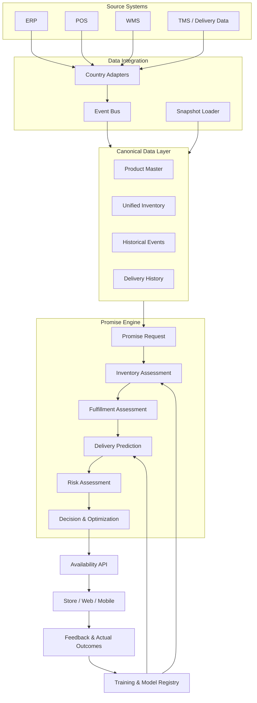
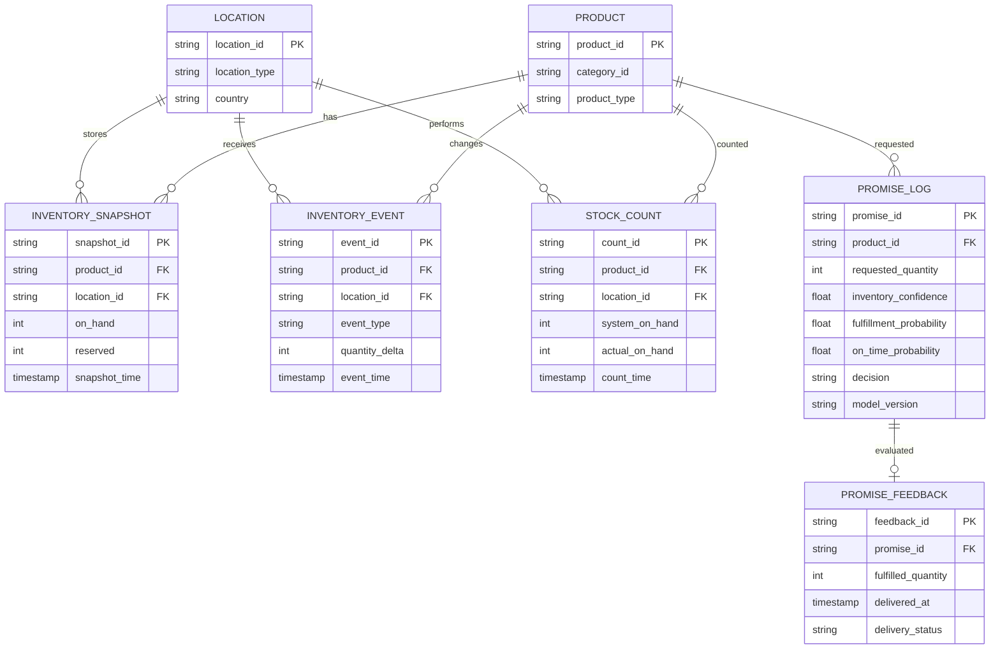

# Promise Engine – Technical Design & Implementation Specification

**Version:** 1.0<br>
**Scope:** MVP 12 weeks<br>
**Approach Model:** Hybrid Rules + Machine Learning + Optimization<br>
**Deployment Architecture:** Read-only integration with ERP / POS / WMS during MVP phase

---

## 1. Objectives and Scope

### 1.1. Objectives

The Promise Engine calculates whether a product commitment to a customer can be met at a given location and time.

Inputs include:

- Products and customer quantities required.
- Delivery location or pickup location.
- The customer's desired delivery date.
- Inventory status from source systems.
- Order processing capacity and transportation capability.

Outputs include:

- Quantity that can be promised.
- Locations able to fulfill the request.
- Expected delivery or pickup date.
- Probability that the promise will be kept.
- Confidence level of the result.
- Reasons and factors influencing the decision.

### 1.2. Design principles

The Promise Engine should not use a single metric to determine whether a commitment is possible.

It therefore evaluates three separate probability groups:

| Components | Meaning | Question to be answered |
|---|---|---|
| Inventory Confidence | Reliability of inventory data | Is the current inventory reliable? |
| Fulfillment Probability | Probability of meeting demand | Can we fulfill the order without shortage? |
| On-time Delivery Probability | On-time delivery probability | Can inventory arrive by the promised date? |

The final result estimates the probability of keeping the whole promise.

### 1.3. MVP Scope

MVP focuses on:

- A pilot country.
- Approximately 15 stores and 1 Distribution Center.
- A selected set of SKUs.
- Data read from ERP, POS, and WMS.
- Calculate available inventory and apply operational rules.
- Predict delivery dates using historical delivery records.
- Record actual results to serve model training.

The MVP does not write inventory updates back to source systems.

---

# 2. Overall Architecture

## 2.1. Logical Architecture



## 2.2. Key Components

| Component | Responsibility |
|---|---|
| Country Adapters | Connect and transform data from the source system |
| Event Bus | Propagate inventory changes and transactions |
| Canonical Data Layer | Standardize product, location, and inventory data |
| Inventory Assessment | Evaluate reliability and stock availability |
| Fulfillment Assessment | Identify sources that can fulfill orders |
| Delivery Prediction | Forecast delivery date and on-time delivery capability |
| Risk Assessment | Aggregate risks affecting promises |
| Decision & Optimization | Select appropriate commitment strategies |
| Feedback & Training | Record actual results and retrain the model |

---

# 3. Training data design

This is the most important foundation for the Promise Engine. A model can predict reliably only if the data records both what was known at decision time and what actually happened afterward.

## 3.1. Data sources

| Source | Data to retrieve | Purpose |
|---|---|---|
| ERP | Product, inventory, reserved stock, purchase orders | Inventory and product status |
| POS | Sales transactions, returns, stock adjustments | Consumption rate and inventory fluctuation |
| WMS | Receipts, picking, packing, stock movements | Order processing capacity and actual inventory |
| TMS / Carrier | Shipment, tracking, delivery timestamps | Delivery model training |
| Store / DC | Stock count, cycle count, discrepancy | Inventory accuracy determination |
| Promise Engine | Promise requests, decisions, confidence, reasons | Preserve what was predicted at decision time |

If the MVP is not connected to TMS, you can use the existing delivery history from ERP or WMS, but you need to evaluate the quality and completeness of this data.

## 3.2. Training data groups

### A. Product and Location

Product characteristics and warehouse location description.

| Field | Type | Description |
|---|---|---|
| product_id | string | Standard product ID |
| category_id | string | Product group |
| product_type | string | Product type |
| storage_type | string | Storage conditions |
| location_id | string | Store or DC |
| location_type | string | STORE / DC |
| country | string | Country |
| region | string | Region |
| handling_class | string | Goods processing group |

These attributes may affect inventory discrepancies, order processing speed, and delivery time.

### B. Inventory Snapshot

Save inventory status at each point in time.

| Field | Type | Description |
|---|---|---|
| snapshot_id | string | Snapshot ID |
| product_id | string | Product |
| location_id | string | Location |
| snapshot_time | timestamp | Time the snapshot was recorded |
| on_hand | integer | Recorded system stock |
| reserved | integer | Reserved quantity |
| allocated | integer | Allocated Quantity |
| inbound | integer | In-Transit Quantity |
| last_count_time | timestamp | Latest Inventory Count |
| source_updated_at | timestamp | System Source Update Time |
| received_at | timestamp | Promise Hub Data Receipt Time |

**Note:** `source_updated_at` and `received_at` must be stored separately to determine synchronization lag.

### C. Inventory Events

Log events that change inventory.

| Field | Type | Description |
|---|---|---|
| event_id | string | Event ID |
| product_id | string | Product |
| location_id | string | Location |
| event_type | string | SALE / RETURN / RECEIPT / ADJUSTMENT / TRANSFER |
| quantity_delta | integer | Quantity Change |
| event_time | timestamp | Business Event Time |
| received_at | timestamp | System Receive Time |
| source_system | string | ERP / POS / WMS |
| transaction_id | string | Source Transaction ID |

The data pipeline must handle duplicate, late, and out-of-order events.

### D. Inventory Count and Discrepancy

This is the important data for training the Inventory Confidence Model.

| Field | Type | Description |
|---|---|---|
| count_id | string | Inventory Count ID |
| product_id | string | Product |
| location_id | string | Location |
| count_time | timestamp | Count time |
| system_on_hand | integer | System inventory before check |
| actual_on_hand | integer | Actual inventory |
| discrepancy | integer | Difference |
| discrepancy_ratio | float | Difference ratio |
| count_type | string | CYCLE_COUNT / FULL_COUNT |
| verified | boolean | Verified or not |

Formula:

$$
Discrepancy = SystemOnHand - ActualOnHand
$$

$$
DiscrepancyRatio =
\frac{|SystemOnHand-ActualOnHand|}
{\max(ActualOnHand,1)}
$$

Example:

- System records: 20 items.
- Physical count: 17 items.
- Discrepancy = 3.
- Discrepancy Ratio = 17.65%.

Do not assume every count is perfectly accurate; the counting process can also make mistakes. Record its source, time, and verification method.

### E. Delivery and Fulfillment History

Data used for training the Delivery Prediction Model.

| Field | Type | Description |
|---|---|---|
| order_id | string | Order ID |
| product_id | string | Product |
| quantity | integer | Quantity |
| source_location_id | string | Warehouse/Store for picking |
| destination_id | string | Pickup point |
| order_created_at | timestamp | Order creation time |
| order_cutoff_time | timestamp | Cutoff time |
| picking_started_at | timestamp | Start picking |
| picking_completed_at | timestamp | End picking |
| packed_at | timestamp | End packaging |
| shipped_at | timestamp | Shipment time |
| promised_at | timestamp | Committed time |
| delivered_at | timestamp | Actual delivery time |
| carrier_id | string | Carrier unit |
| delivery_type | string | HOME / STORE_PICKUP |
| delivery_status | string | Final status |

If data exists, add:

- Route distance.
- Number of stops.
- Warehouse workload.
- Carrier capacity.
- Weather or seasonal features.
- Failed delivery attempts.
- Delivery exception reason.

It is not necessary to have all fields in the MVP.

### F. Promise Decision Log

All decisions must be recorded for model evaluation.

| Field | Type | Description |
|---|---|---|
| promise_id | string | Promise ID |
| request_time | timestamp | Request time |
| product_id | string | Product |
| requested_quantity | integer | Request quantity |
| destination_id | string | Point of receipt |
| selected_source_id | string | Selected supply source |
| inventory_confidence | float | Inventory reliability |
| fulfillment_probability | float | Stock fulfillment probability |
| on_time_probability | float | On-time delivery probability |
| promise_success_probability | float | Overall success probability |
| promised_at | timestamp | Promised date |
| decision | string | PROMISE / VERIFY / REJECT |
| decision_reason | json | Influencing factors |
| rules_version | string | Policy version |
| model_version | string | Model version |

**Required:** Store the features and computed outputs as they were at decision time. Do not reconstruct them later from updated data and assume that information was available when the promise was made.

---

# 4. Build training labels (Training Labels)

Need to build a separate label for each problem, rather than training a unified model from the start.

## 4.1. Inventory Confidence Model

**Objective:** Predict the system inventory data within an acceptable error margin compared to actual inventory.

Binary label:

$$
Y_{inventory} =
\begin{cases}
1 & \text{If } |SystemStock-ActualStock| \leq Tolerance\\
0 & \text{Otherwise}
\end{cases}
$$

Example:

- Tolerance =  1 product or an approved error rate.
- System records 20, physical count 19 → label 1.
- System records 20, physical count 15 → label 0.

Should evaluate additional tolerances for different product groups and inventory scales.

**Model output:**

$$
P(InventoryAccurate \mid X)
$$

This is the probability of inventory data accuracy, not the order fulfillment probability.

## 4.2. Fulfillment Probability Model

**Objective:** Forecast the ability to meet the required quantity at a supply source.

Label:

$$
Y_{fulfillment} =
\begin{cases}
1 & \text{If meets required quantity}\\
0 & \text{If does not meet quantity}
\end{cases}
$$

The label should be determined from the actual picking/fulfillment result, compared with the required quantity by customers.

Example:

- Requested quantity = 10.
- Picked quantity = 10 → label 1.
- Picked quantity = 8 → label 0 if the order requires 10.

Do not use canceled orders due to customer changes as label failures if the reason is not related to inventory.

## 4.3. Delivery Prediction Model

**Objective:** Forecast the ability to deliver on the promised time.

Label:

$$
Y_{on\_time} =
\begin{cases}
1 & \text{If DeliveredAt} \leq \text{PromisedAt}\\
0 & \text{If delivered late}
\end{cases}
$$

Special cases to handle:

- Pre-shipment cancellation.
- Order not delivered due to customer absence.
- Order canceled due to stock shortage.
- Order with commitment date changed.
- Order without valid delivery timestamp.

Do not combine all the above cases into label 0. Need to classify the root causes to avoid model bias.

## 4.4. Promise Success Model

In the initial phase, the overall success probability can be calculated from the components.

$$
P(PromiseSuccess)
=
P(FulfillmentSuccess \cap OnTime)
$$

If we assume two events are independent:

$$
P(PromiseSuccess)
\approx
P(FulfillmentSuccess)
\times
P(OnTime)
$$

This is only an approximation. In reality, two factors may be interdependent, for example, warehouse overload may increase the risk of stock shortage and delay delivery.

The MVP phase should use this calculation with clearly stated assumptions. When sufficient data is available, build a joint probability model or simulation to directly calculate the overall success probability.

---

# 5. Feature Engineering Design

## 5.1. Inventory Confidence features

| Feature | Description | Source |
|---|---|---|
| stock_age_hours | Hours since last inventory update | ERP / WMS |
| days_since_last_count | Days since last physical count | Stock Count |
| sales_velocity_7d | 7-day sales velocity | POS |
| sales_velocity_30d | 30-day sales velocity | POS |
| stock_adjustment_rate | Inventory adjustment ratio | ERP / WMS |
| historical_discrepancy | Historical physical count variance | Stock Count |
| pending_transactions | Out-of-sync transactions count | POS / ERP |
| source_latency | Source data latency | Integration |
| stock_level | Current inventory count | ERP / WMS |
| product_category | Product Group | Product Master |
| location_type | Store / DC | Location |

Time-based features must be calculated using data available at `request_time`, to avoid data leakage.

## 5.2. Fulfillment features

| Feature | Description |
|---|---|
| requested_quantity | Requested quantity |
| effective_atp | Available-to-Promise after excluding non-promiseable portions |
| inventory_confidence | Stock Reliability Probability |
| sales_velocity | Consumption Rate |
| pending_allocations | Quantity in Allocation Queue |
| inbound_reliability | Inbound Reliability |
| location_type | Location Type |
| warehouse_capacity | Remaining Processing Capacity |
| picking_workload | Current Picking Volume |

## 5.3. Delivery Prediction features

| Feature | Description |
|---|---|
| source_location | Shipping warehouse or store |
| destination_region | Receiving area |
| distance | Transportation distance |
| carrier_id | Shipping unit |
| delivery_type | Delivery method |
| order_hour | Order creation time |
| order_weekday | Day of the week |
| cutoff_remaining | Remaining time to cutoff |
| picking_workload | Warehouse processing load |
| historical_lane_delay | Historical delays on the lane |
| carrier_on_time_rate | On-time delivery rate of carrier |
| order_size | Order scale |
| seasonality | Peak season or peak event |

Remove all features that appear after the delivery event has occurred, for example `delivered_at`, when training the pre-delivery forecast model.

---

# 6. Modeling Strategy

## 6.1. Overall Strategy

Do not include all problems in a single model.

Propose three independent models:

| Model | Problem | Output |
|---|---|---|
| Inventory Confidence Model | Inventory accuracy | Probability 0–1 |
| Fulfillment Model | Quantity fulfillment capability | Probability 0–1 |
| Delivery Model | On-time delivery capability | Probability 0–1 |

Promise Decision Layer synthesizes results from models and business rules.

## 6.2. Phase 1 – Rule-based Baseline

The goal is to build a system that operates even when sufficient training data is not available.

### Inventory Confidence Rules

Initialize confidence = 100, then subtract points based on risks.

Example:

| Condition | Reference points deducted |
|---|---:|
| More than 30 days since the last count | -15 |
| Transaction desynchronization | -20 |
| High historical discrepancy | -20 |
| High sales velocity product | -10 |
| Slow data source | -15 |

$$
ConfidenceScore =
\max(0,100-\sum Penalties)
$$

Initial grouping:

| Score | Band | Meaning |
|---:|---|---|
| ≥85 | HIGH | Can continue to consider commitment |
| 65–84 | MEDIUM | Verify stock or reduce the promised quantity |
| <65 | LOW | Should not commit automatically |

The penalties and thresholds are initial values for pilot, not verified thresholds. Need to be adjusted with actual data.

### ATP Calculation

$$
ATP = OnHand - Reserved - Allocated - SafetyBuffer
$$

Where:

$$
SafetyBuffer =
OnHand \times (1-Confidence/100)\times k
$$

`k` is the initial adjustment coefficient, e.g. 0.5. Need to adjust based on product group, location, and risk level.

Do not include inbound stock in default ATP. Only calculate inbound when:

- There is an expected arrival time.
- There is sufficient supply chain reliability.
- Goods arrive before the required fulfillment time.
- Can receive and process goods in accordance with the procedure.

### Delivery Rules

$$
EstimatedDelivery =
Cutoff + ProcessingTime + TransitTime
$$

Need to consider further:

- Warehouse schedule.
- Days off.
- Picking/packing time.
- Line shipping time.
- Carrier cutoff time.
- Current processing capacity.

## 6.3. Stage 2 – Machine Learning

### A. Inventory Confidence Model

**Initial model:** Logistic Regression or Gradient Boosting.

Proposal:

- Logistic Regression to create an interpretable baseline.
- LightGBM / XGBoost / HistGradientBoosting to capture nonlinear relationships.
- Calibrated probabilities to ensure output reflects actual probabilities.

Input: features from section 5.1.

Output:

$$
P(|SystemStock-ActualStock|\leq Tolerance)
$$

Example:

```json
{
  "inventory_confidence": 0.94,
  "confidence_band": "HIGH"
}
```

### B. Fulfillment Model

The goal is to forecast the ability to meet the required quantity.

Proposed model:

- Logistic Regression baseline.
- Gradient Boosting when sufficient data is available.
- It is possible to add a model that forecasts the skewed inventory distribution to calculate the probability of having sufficient stock.

If the Inventory Confidence model forecasts the accurate probability of stock levels, it should not be directly used as the probability of fulfilling an order. It needs to be combined with the order quantity, available inventory, stock deviation, and allocation rules.

### C. Delivery Prediction Model

**Proposed model:** Gradient Boosting Classifier.

Goal:

$$
P(OnTime \mid X)
$$

Output:

```json
{
  "on_time_probability": 0.96,
  "predicted_delivery_date": "2026-12-10"
}
```

The model should forecast the probability of on-time delivery per delivery date scenario, rather than forecasting a single average shipping time.

### D. Probability Calibration

This is a mandatory step before using probability to commit.

Methods:

- Platt Scaling.
- Isotonic Regression.

Evaluated by:

- Brier Score.
- Reliability Diagram.
- Expected Calibration Error (ECE), if applicable.
- Precision / Recall at decision thresholds.

Example:

If the model predicts 100 cases with a 90% success probability, approximately 90 cases need to succeed. If only 70 cases succeed, the model is overly confident.

## 6.4. Split the training data

Do not randomly split the data because the data has temporal factors.

Recommendation:

| Dataset | Time window |
|---|---|
| Training | First historical stages |
| Validation | Next historical stage |
| Test | Most recent historical stage |

Example if data spans 12 months:

- Training: months 1–8.
- Validation: months 9–10.
- Test: months 11–12.

Ensure that future records do not leak into past records' features.

Also evaluate generalization capability across stores, warehouses, and product categories.

## 6.5. Conditions for transitioning from Rules to ML

Only enable ML in production when:

1. Training labels are sufficient in quantity and quality.
2. Reasonable coverage data by store, product, and time.
3. Better model than baseline on independent test set.
4. Calibrated probabilities.
5. No significant degradation in critical product or location groups.
6. Model version, monitoring, and rollback are in place.

If conditions are not met, continue using Rules.

---

# 7. Promise Request Processing Procedure

## 7.1. Step 1 – Receive Request

Input:

- Product ID.
- Requested quantity.
- Destination.
- Delivery type.
- Requested delivery date.
- Customer service level, if applicable.

Check and standardize input data and product/location identifiers.

## 7.2. Step 2 – Check data quality

Check:

- Has the product been mapped correctly?
- Does the location exist?
- Is the inventory snapshot sufficient?
- Are there missing or unsynchronized events?
- Are there duplicate transactions?
- Are there any abnormal data?

If the data does not meet the requirements, do not automatically provide a high-confidence guarantee.

## 7.3. Step 3 – Inventory Assessment

Calculate:

- Inventory Confidence.
- Confidence Band.
- ATP.
- Safety Buffer.
- Estimated Available Quantity.

Pseudo-code:

```python
def assess_inventory(stock, reserved, allocated, features):
    confidence = inventory_model.predict_proba(features)

    safety_buffer = (
        stock.on_hand
        * (1 - confidence)
        * stock.buffer_factor
    )

    atp = (
        stock.on_hand
        - reserved
        - allocated
        - safety_buffer
    )

    return {
        "confidence": confidence,
        "atp": max(0, atp)
    }
```

In production, additional validation, rounding quantities, handling missing data, and business threshold controls need to be added.

## 7.4. Step 4 – Assess fulfillment

Identify potential supply sources:

- DC.
- Store near customer.
- Allowed fulfillment locations.

Remove suppliers that do not meet criteria:

- ATP below required quantity.
- Confidence below threshold.
- Unable to pick.
- Does not meet cutoff.
- Does not support corresponding delivery type.

## 7.5. Step 5 – Delivery Prediction

For each valid supplier:

1. Determine the earliest possible processing time.
2. Calculate picking and packing time.
3. Calculate shipping time.
4. Apply work schedule and cutoff.
5. Calculate on-time delivery probability.
6. Evaluate feasible delivery dates.

## 7.6. Step 6 – Risk Assessment

Aggregate factors:

- Inventory risk.
- Fulfillment risk.
- Shipping risk.
- Data synchronization risk.
- Processing capacity risk.

Overall probability in MVP:

$$
P_{success} =
P_{fulfillment}\times P_{on-time}
$$

The formula above is only an approximation under the assumption of independence. When sufficient data is available, the joint probability model should be evaluated to handle correlations between factors.

## 7.7. Step 7 – Promise Decision

Initial proposed threshold:

| Probability | Decision | Meaning |
|---:|---|---|
| ≥95% | PROMISE | May promise automatically |
| 85–94.99% | VERIFY | Requires checking or selecting an alternative option |
| <85% | REJECT | Should not commit |

These thresholds must be adjusted with Product and Operations based on carry costs, cancellation rates, revenue loss, and promise acceptance rates.

Should not only maximize success probability. The system needs to balance reliability and promise coverage (the percentage of requests that can be fulfilled).

## 7.8. Step 8 – Fulfillment Optimization

When multiple feasible supply options are available, select the optimal option.

Reference objective function:

$$
Minimize:
C_{transport}
+C_{handling}
+C_{split}
+C_{delay}
+C_{risk}
$$

Constraints:

- The total quantity selected must meet the requested quantity.
- Do not exceed ATP.
- Do not exceed processing capacity.
- Must meet delivery time.
- Comply with supply and transportation regulations.

Tools that can be used:

- Google OR-Tools.
- Mixed Integer Linear Programming (MILP).
- Constraint Programming.

**MVP Limitation:** Prioritize one supply source. If insufficient, try another DC source or up to two supply sources. Optimize full multi-source for Phase 2.

## 7.9. Step 9 – Record decision and feedback

Each evaluation must be saved:

- Input request.
- Used data snapshot.
- Feature vector.
- Model/rules version.
- Result per component.
- Final decision.
- Reason.
- Actual fulfillment result.
- Actual delivery result.

Feedback used to update training labels and model effectiveness evaluation.

---

# 8. Design API

## 8.1. API Overview

| Method | Endpoint | Purpose |
|---|---|---|
| POST | `/v1/promises/evaluate` | Commitment assessment |
| GET | `/v1/promises/{promise_id}` | Obtain evaluation results |
| POST | `/v1/promises/{promise_id}/confirm` | Confirm commitment usage |
| POST | `/v1/promises/{promise_id}/feedback` | Send actual results |
| GET | `/v1/availability` | Query capability for inventory |
| GET | `/v1/models/versions` | View model version |
| GET | `/v1/health` | Health check |

In the MVP, the following three APIs can be deployed first: evaluate, confirm, and feedback. The remaining APIs can be added as needed.

## 8.2. POST /v1/promises/evaluate

**Purpose:** Evaluate the capability to meet a requirement and return a commitment plan.

Request:

```json
{
  "request_id": "REQ-10001",
  "product_id": "SKU-001",
  "quantity": 2,
  "destination": {
    "location_id": "STORE-001",
    "type": "STORE_PICKUP"
  },
  "requested_delivery_date": "2026-12-10",
  "delivery_type": "STORE_PICKUP",
  "service_level": "STANDARD"
}
```

Response:

```json
{
  "promise_id": "PRM-10001",
  "request_id": "REQ-10001",
  "decision": "PROMISE",
  "promised_quantity": 2,
  "promised_delivery_date": "2026-12-10",
  "selected_source": {
    "location_id": "DC-001",
    "location_type": "DC"
  },
  "probabilities": {
    "inventory_confidence": 0.98,
    "fulfillment_probability": 0.97,
    "on_time_probability": 0.98,
    "promise_success_probability": 0.9506
  },
  "inventory": {
    "on_hand": 20,
    "reserved": 5,
    "allocated": 2,
    "safety_buffer": 2,
    "atp": 11
  },
  "risk_band": "HIGH",
  "reason_codes": [
    "INVENTORY_DATA_FRESH",
    "STOCK_AVAILABLE",
    "DELIVERY_LANE_RELIABLE"
  ],
  "model_versions": {
    "inventory": "inventory-v1.0",
    "fulfillment": "fulfillment-v1.0",
    "delivery": "delivery-v1.0"
  },
  "evaluated_at": "2026-11-05T10:30:00Z"
}
```

Note: `promise_success_probability` in this example is calculated as `0.97 × 0.98 = 0.9506`, assuming independence.

### Decision values

| Value | Meaning |
|---|---|
| PROMISE | Committable |
| VERIFY | Requires additional checks |
| REJECT | Not committable |

### Risk Band values

| Value | Meaning |
|---|---|
| HIGH | Low risk |
| MEDIUM | Caution required |
| LOW | High risk |

The name `risk_band` should be consistently understood: HIGH here refers to high confidence, not high risk. To avoid confusion, it should be changed to `confidence_band`.

## 8.3. GET /v1/promises/{promise_id}

Retrieve saved evaluation results.

Response:

```json
{
  "promise_id": "PRM-10001",
  "decision": "PROMISE",
  "promised_quantity": 2,
  "promised_delivery_date": "2026-12-10",
  "promise_success_probability": 0.9506,
  "status": "EVALUATED"
}
```

This API should return historical results at the time of evaluate, not recompute using a new model.

## 8.4. POST /v1/promises/{promise_id}/confirm

**Purpose:** Confirm that the sales system or user has adopted the commitment plan.

Request:

```json
{
  "confirmed_by": "SYSTEM",
  "confirmed_at": "2026-11-05T10:32:00Z",
  "selected_option": "OPTION-001"
}
```

Response:

```json
{
  "promise_id": "PRM-10001",
  "status": "CONFIRMED",
  "confirmed_at": "2026-11-05T10:32:00Z"
}
```

This is a business decision recording step, not an inventory reservation command in ERP/WMS.

## 8.5. POST /v1/promises/{promise_id}/feedback

**Purpose:** Record actual results to evaluate accuracy and train the model.

Request:

```json
{
  "actual_fulfillment": {
    "requested_quantity": 2,
    "fulfilled_quantity": 2,
    "fulfilled_at": "2026-11-06T08:00:00Z"
  },
  "actual_delivery": {
    "promised_at": "2026-12-10T18:00:00Z",
    "delivered_at": "2026-12-10T15:30:00Z",
    "delivery_status": "DELIVERED"
  },
  "inventory_verification": {
    "system_on_hand": 20,
    "actual_on_hand": 19,
    "counted_at": "2026-11-06T08:00:00Z"
  },
  "failure_reason": null
}
```

Response:

```json
{
  "promise_id": "PRM-10001",
  "feedback_status": "ACCEPTED",
  "labels": {
    "inventory_accurate": true,
    "fulfillment_success": true,
    "on_time": true
  }
}
```

Label `inventory_accurate` should be calculated based on the configured tolerance. Do not consider any unit deviation as accurate by default.

## 8.6. GET /v1/availability

**Purpose:** Provide availability information for frontend or POS systems.

Example:

```http
GET /v1/availability?product_id=SKU-001&location_id=STORE-001&quantity=2
```

Response:

```json
{
  "product_id": "SKU-001",
  "location_id": "STORE-001",
  "requested_quantity": 2,
  "available_to_promise": 11,
  "inventory_confidence": 0.98,
  "availability_status": "AVAILABLE",
  "evaluated_at": "2026-11-05T10:30:00Z"
}
```

API availability only indicates the presence of stock. If the delivery date and the ability to fulfill the promise are required, the frontend must use Promise Evaluate.

## 8.7. API Error Handling

Standardize errors:

| HTTP Status | Error Code | Meaning |
|---|---|---|
| 400 | INVALID_REQUEST | Invalid request |
| 401 | UNAUTHORIZED | Unauthenticated |
| 403 | FORBIDDEN | Insufficient permissions |
| 404 | PRODUCT_NOT_FOUND | Product not found |
| 404 | LOCATION_NOT_FOUND | Location not found |
| 409 | DUPLICATE_REQUEST | Invalid duplicate request |
| 422 | DATA_NOT_READY | Insufficient data to evaluate |
| 429 | RATE_LIMITED | API call limit exceeded |
| 500 | INTERNAL_ERROR | Internal error |
| 503 | SOURCE_UNAVAILABLE | Unavailable source system |

Example:

```json
{
  "error": {
    "code": "DATA_NOT_READY",
    "message": "Inventory data is too old to provide a reliable promise.",
    "details": {
      "location_id": "STORE-001",
      "product_id": "SKU-001",
      "last_updated_at": "2026-11-04T08:00:00Z"
    }
  }
}
```

## 8.8. API Non-functional Requirements

| Requirement | MVP Goal |
|---|---|
| API latency | p95 < 500 ms |
| Availability | Internal SLA of the pilot |
| Authentication | OAuth2 / OIDC |
| Authorization | Role-based access |
| Idempotency | Support request idempotency |
| Observability | Logs, metrics, traces |
| Versioning | `/v1/` |
| Audit | Store decision and model version |
| Data privacy | Do not use customer personal data in MVP |

Performance thresholds must be validated through real load testing and depend on the number of locations, query patterns, and cache usage.

---

# 9. Data Model and Storage

## 9.1. Core Tables



## 9.2. Storage Technology References

| Component | Technology |
|---|---|
| Operational database | PostgreSQL |
| Cache | Redis |
| Event streaming | Kafka-compatible event bus |
| Raw historical data | Object Storage |
| Search / diagnostics | OpenSearch, if needed |
| ML artifacts | Object Storage + Model Registry |

Not all components need to be implemented in MVP. PostgreSQL, object storage, and a suitable event bus can meet most initial requirements.

---

# 10. Evaluate and monitor the model

## 10.1. Model Evaluation Metrics

| Model | Metric | Evaluation goals |
|---|---|---|
| Inventory Confidence | Brier Score | Probability accuracy |
| Inventory Confidence | Precision / Recall | False inventory detection |
| Fulfillment | Precision / Recall | Demand fulfillment forecast |
| Delivery | Brier Score | On-time delivery probability calibration |
| Delivery | AUC / PR-AUC | On-time vs. delayed distinction capability |
| Promise Engine | Promise Accuracy | Success promise rate |
| Promise Engine | Promise Coverage | Committed request rate |

Do not evaluate the model only by Accuracy. In the context of Promise Engine, the probability calibration and the level of control over false promises are more important.

## 10.2. Business KPIs

| KPI | Formula / Meaning |
|---|---|
| Inventory Accuracy | Inventory record rate within tolerance |
| Fulfillment Success Rate | Sufficient quantity order rate |
| Promise Accuracy | Successful promise execution rate |
| On-time Delivery | On-time delivery rate |
| Promise Coverage | Committed request rate |
| Manual Verification Rate | Manual check required request rate |
| Brier Score | Predicted probability accuracy |
| API Response Time | API response time |

Report KPIs by:

- Product category.
- Store / DC.
- Country / Region.
- Delivery type.
- Confidence band.
- Requested quantity.
- Model version.

## 10.3. Monitoring and Alerting

Monitoring issues:

- Inventory data freshness decreases.
- Event processing lag increases.
- Inventory discrepancy rate increases.
- Promise accuracy decreases.
- Calibration drift.
- Abnormal increase in VERIFY requests rate.
- Model inference latency increases.
- Source system connection loss.

When model drift or abnormal input data is detected, the system must be able to switch to Rules Baseline.

---

# 11. MVP Deployment Plan (12 weeks)

| Stage | Week | Work | Deliverables |
|---|---:|---|---|
| Data Foundation | 1–2 | ERP/POS/WMS integration, canonical schema, snapshot and event | Unified Inventory |
| Inventory Intelligence | 3–4 | Inventory rules, discrepancy, confidence, ATP | Inventory Assessment |
| Rules-based Promise | 5–6 | Promise API, delivery rules, decision logic | Promise Engine v1 |
| ML Enhancement | 7–8 | Label preparation, baseline training, calibration | ML models v1 |
| Pilot | 9–10 | Frontend integration, feedback, trial operation | Pilot Release |
| Evaluation | 11–12 | KPI measurement, model evaluation, optimization and rollback test | MVP Evaluation Report |

## 11.1. MVP Completion Conditions

- Product and location data standardization.
- Inventory snapshot/event reception and processing.
- Inventory Confidence Rules.
- ATP calculation.
- Has Delivery Prediction baseline.
- Has Promise Evaluate API.
- Stores Promise Decision Log.
- Records feedback and actual outcome.
- Has KPI dashboard.
- Can fallback from ML to Rules.

ML is not a mandatory condition for MVP completion. If training data is insufficient, prioritize operational stability using rules.

---

# 12. Technical decisions need to be consistent

Before starting implementation, need to finalize the following issues:

| Topic | Decisions to be made |
|---|---|
| Inventory tolerance | How much deviation is considered accurate inventory? |
| Confidence thresholds | What is the HIGH / MEDIUM / LOW threshold? |
| Safety buffer | Formulas and coefficients per product group? |
| Inbound stock | Under what conditions may inbound units be included in ATP? |
| Promise SLA | What is the minimum probability for automatic commitment? |
| Delivery target | Commitment by day or by time window? |
| Fulfillment policy | Prioritize DC, Store, or nearest source? |
| Multi-source | Is it allowed to split orders from multiple locations? |
| Feedback | Which system is the source of truth for fulfillment and delivery outcome? |
| Model governance | Who approves the model before production? |

---

# 13. Deployment recommendations

## Priority 1 – Reliable Promise

Focus on clean data, synchronized inventory, reliability control, and ATP rules. This is the mandatory foundation.

## Priority 2 – Predictive Promise

Deploy the Inventory Confidence Model and Delivery Prediction Model after sufficient inventory counts and delivery history are available.

## Priority 3 – Optimized Promise

Optimize multiple supply sources, fulfillment costs, and operational capacity once the system is stable.

**Important Recommendation:** Do not start by building a complex ML model to predict the final promise. Instead, build three meaningful business-level probability layers, evaluate each layer independently, and then combine them into a Promise Decision.

> Traditional inventory systems tell us what the system thinks we have. Promise Engine tells us what we can confidently commit to our customers.

**Know → Predict → Commit.**
